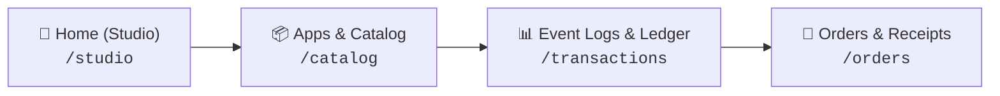
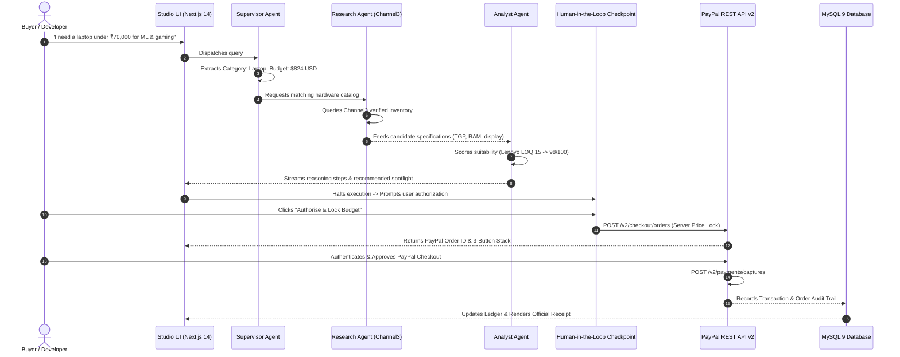

# 🚀 PayPilot AI

> **Autonomous Multi-Agent FinTech Shopping Platform Built on Official PayPal Developer Rails**  
> *Built for the **PayPal AI Hackathon 2026** — Agentic Commerce Track*  
> 🔗 **GitHub Repository:** [https://github.com/abhisheksenku/PayPilot-AI](https://github.com/abhisheksenku/PayPilot-AI)

PayPilot AI transforms modern agentic commerce through an autonomous multi-agent swarm governed by a **strict human-in-the-loop authorization checkpoint**. Users specify high-level computing requirements, use cases, and budget in natural language (e.g. *"I need a laptop under ₹70,000 for machine learning and gaming"*). A coordinated swarm of AI agents discovers genuine hardware via Channel3, scores technical benchmarks (GPU TGP wattage, thermal headroom, memory bandwidth), drafts orders, and halts for user authorization before capturing payments securely via official **PayPal Sandbox REST API v2**.

The platform is designed in the official **PayPal Developer Console Light Theme** (`#F5F7FA` canvas, `#FFFFFF` cards, `#0070BA` classic blue, `#003087` deep navy) featuring dual persistent banners, a 100% full-height left navigation sidebar, and four interactive workstations.

---

## 🏆 Hackathon Alignment & Key Innovations

| Objective | How PayPilot AI Delivers |
| :--- | :--- |
| **1. Meaningful Multi-Agent Swarm** | Deterministic LangGraph state machine with 4 coordinated agents: **Supervisor Node** (requirement extraction & currency translation), **Shopping Research Node** (Channel3 hardware discovery), **Product Analyst Node** (multi-attribute benchmark ranking), and **Purchase Guardrail Node** (server price locking & escrow validation). |
| **2. Mandatory Human-in-the-Loop Checkpoint** | Solves the critical financial safety problem of autonomous AI: agents have full autonomy to research, rank, and stage orders, but **zero authority** to charge funds without explicit user biometric or PayPal credential approval. |
| **3. Authentic PayPal Checkout Stack** | Official 3-button stack (**PayPal Checkout**, **Pay Later**, and **Debit/Credit Card**) powered by PayPal REST API v2 (`/v2/checkout/orders` & `/v2/payments/captures`) and the `@paypal/react-paypal-js` SDK. |
| **4. Pixel-Perfect PayPal Developer Console UI** | Faithfully matches the official PayPal Developer experience with dual notification tickers (SDK v6 announcement + Sandbox mode warning), `Ctrl+K` global search, Level 3 Guardrail policies, and real-time telemetry rails. |
| **5. Full Financial Lifecycle & Ledger** | Complete post-transaction audit trail with simulated REST API v2 webhook dispatchers (`PAYMENT.CAPTURE.COMPLETED`), printable itemized PDF invoices with QR verification, and escrow hold tracking. |

---

## 🖼️ Workstation & Screen Tour

PayPilot AI is organized into four core screens accessible via the left sidebar:



### 1. Home (Shopping Studio) — `/studio`
- **Dual-Pane Hero Workspace**:
  - **Left Pane (48%)**: Real-time 4-agent reasoning stream with live status chips, human-in-the-loop authorization trigger, and interactive bottom query bar.
  - **Right Pane (52%)**: Hardware Spotlight card showcasing the #1 ranked recommendation (Lenovo LOQ 15), Channel3 trust badge, 98/100 AI Suitability Score, 3-button authentic PayPal checkout stack, and server price lock guarantee.
- **Interactive PayPal Checkout Modal**:
  - Live sandbox order creation with server price lock validation, itemized subtotal, and instant settlement simulation.

### 2. Apps & Product Catalog — `/catalog`
- **Filter Controls**:
  - Category selector (`All`, `ML Laptops`, `MacBooks`, `Workstations`).
  - Brand filter dropdown (`All Brands`, `Lenovo`, `Apple`, `HP`, `ASUS`, `Dell`).
  - Active budget constraint pill (`Budget: Under ₹70,000 ($824 USD)`).
- **3x2 Responsive Hardware Grid**:
  - 6 Channel3 verified hardware models with custom vector renders (`LaptopVisual.tsx`):
    1. **Lenovo LOQ 15** ($749.00 USD • 98/100 Score • Top Pick #1)
    2. **Apple MacBook Pro 14 M3 Pro** ($1,849.00 USD • 94/100 Score)
    3. **HP Victus 15** ($699.00 USD • 87/100 Score)
    4. **ASUS ROG Zephyrus G16** ($1,499.00 USD • 95/100 Score)
    5. **Dell G15 Gaming** ($779.00 USD • 89/100 Score)
    6. **Lenovo Legion Pro 5** ($1,299.00 USD • 97/100 Score)
  - Interactive wishlist hearts, benchmark spec chips (GPU TGP, RAM, Display), and *Inspect in Studio* navigation.

### 3. Event Logs & Financial Ledger — `/transactions`
- **Top 3 KPI Metric Cards**:
  - `Total Volume`: **$4,215.00 USD** (`▲ +100.0%` • *Sandbox Test • Last 7 days*)
  - `Settled Captures`: **6** (`▲ +6` • *Completed payments CAPTURED*)
  - `Active Escrows`: **1** (`— 0%` • *Authorized ON_HOLD • Awaiting capture*)
- **Toolbar & Actions**:
  - Real-time search across Transaction ID, Order ID, and Hardware names.
  - Settlement status dropdown (`All Statuses`, `CAPTURED`, `ON_HOLD`, `PENDING`, `REFUNDED`).
  - Date window selector (`Last 7 Days`, `Last 24 Hours`, `Last 30 Days`).
  - Working **Export CSV** button downloading verified settlement audit tables.
- **8-Column Ledger Table**:
  - 1-click clipboard copy buttons with visual checkmark feedback for Transaction ID, PayPal Order ID, and Capture ID.
  - Interactive **REST API v2 Webhook Payload Inspector Modal** displaying verified `PAYMENT.CAPTURE.COMPLETED` JSON payloads.
- **Tab Switching**:
  - `📑 Transaction Logs`: Full granular data table.
  - `📊 Ledger Summary`: Financial breakdown (Gross Captured Volume, Net Payouts, Settlement Speed).
  - `⚡ Webhooks`: Real-time HTTP 200 OK webhook dispatcher receiver.

### 4. Orders & Digital Receipts — `/orders`
- **Top 3 KPI Metric Cards**:
  - `Total Orders Processed`: **6 Orders** (`▲ +100%` • *All Sandbox Settled*)
  - `Fulfillment Status`: **100% Dispatched** (*6 Delivered / In Transit*)
  - `Net Invoiced Volume`: **$6,874.00 USD** (*Full Seller Protection*)
- **Two-Column Workstation**:
  - **Left Pane (`col-span-7`)**: Order history table with radio selectors, customer names, payment channels, and `✔ DELIVERED` / `✔ IN TRANSIT` / `ON_HOLD` status tags.
  - **Right Pane (`col-span-5`)**: Dynamic Official PayPal Digital Sales Receipt & Tax Invoice with dual PayPal logo, `SANDBOX RECEIPT` badge, vector QR verification code, itemized pricing breakdown, and `✔ PayPal Verified Merchant Paid` guarantee.
- **Actions**:
  - **Download PDF Receipt**: Triggers system print formatting.
  - **Resend to Buyer**: Dispatches simulated digital invoice with toast feedback.
  - **+ Create Manual Invoice**: Interactive modal to issue simulated sandbox merchant invoices.

---

## 🏗️ Multi-Agent Architecture & Flow



---

## 🛠️ Technology Stack

- **Frontend:** Next.js 14 (App Router), React 18, Tailwind CSS, Lucide Icons, TypeScript
- **Payments:** Official PayPal JavaScript SDK (`@paypal/react-paypal-js`), PayPal REST APIs v2 (Orders v2 & Captures v2), PayPal Sandbox
- **Backend:** Node.js, Express.js, TypeScript, Sequelize ORM
- **Database:** MySQL 9.3 (`paypilot_ai` schema, 8 tables)
- **Artificial Intelligence:** Multi-Agent LangGraph Swarm with Google Gemini & Deterministic Fallbacks
- **Product Discovery:** Channel3 Integration + High-Performance Catalog Fallback
- **Design System:** Official PayPal Developer Console Light Theme (`#F5F7FA`, `#FFFFFF`, `#0070BA`, `#003087`)

---

## ⚡ Quick Start & Verification

### 1. Start the Express Backend (Port 5000)
```bash
cd backend
npm install
npm run build
node dist/server.js
```
The backend initializes the database connection and serves endpoints at `http://localhost:5000/api`.

### 2. Start the Next.js Frontend (Port 3000)
```bash
cd frontend
npm install
npm run dev
```
Open **[http://localhost:3000](http://localhost:3000)** in your browser.

---

## 🧪 Testing & Verification Scripts

The repository includes automated live verification scripts:

1. **PayPal Sandbox REST API v2 Test**:
   ```bash
   cd backend
   npx ts-node src/scripts/testPayPal.ts
   ```
   *Connects to MySQL, queries the catalog, and creates an authentic live order on `api-m.sandbox.paypal.com`.*

2. **Multi-Agent Engine Test**:
   ```bash
   cd backend
   npx ts-node src/scripts/testAgentLive.ts
   ```
   *Executes the complete Supervisor $\to$ Research $\to$ Analyst agent loop and logs the execution audit trail to MySQL.*

3. **Frontend Lint & Type Check**:
   ```bash
   cd frontend
   npm run lint
   npx tsc --noEmit
   ```
   *Verifies 0 ESLint errors and 0 TypeScript type errors.*

---

## 📄 License
MIT © 2026 PayPilot AI Team • Built with ❤️ for the PayPal AI Hackathon 2026.
