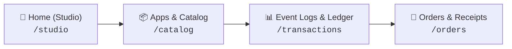
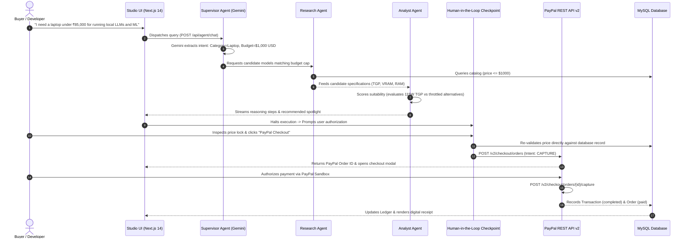

# 🚀 PayPilot AI

> **An Intelligent Purchasing Agent that Researches, Evaluates, and Executes Complex Purchases with User-Controlled Financial Authorization.**  
> *Built for the **Google DeepMind × Google Cloud Startup Buildathon India 2026** (Powered by Google Gemini & Official PayPal Rails)*  
> 🔗 **GitHub Repository:** [https://github.com/abhisheksenku/PayPilot-AI](https://github.com/abhisheksenku/PayPilot-AI)

PayPilot AI transforms high-consideration technical commerce through a coordinated multi-agent AI swarm governed by a **strict Human-in-the-Loop (HITL) authorization checkpoint**. Instead of spending hours deciphering deceptive GPU wattage ratings (TGPs), soldered RAM constraints, and thermal throttling limits across retail tabs, users state their workload constraints in plain English:

> *"I need a laptop under ₹85,000 for running local LLMs, machine learning experiments, and software development."*

A coordinated swarm of AI agents decomposes requirements, extracts constraints (normalizing INR to USD), evaluates technical specifications (GPU TGP wattage, VRAM bandwidth, thermal headroom), drafts the purchase order, and halts for user authorization before capturing payments securely via official **PayPal Sandbox REST API v2**.

---

## 🏆 Buildathon Alignment & Key Innovations

| Dimension | How PayPilot AI Delivers |
| :--- | :--- |
| **1. Meaningful Multi-Agent Swarm** | State machine architecture coordinating discrete specialized agents: **Supervisor Agent** (constraint extraction & currency normalization via Google Gemini), **Shopping Research Agent** (hardware catalog discovery), **Product Analyst Agent** (multi-attribute benchmark scoring & trade-off analysis), and **Purchase Guardrail Agent** (server-side price validation & PayPal order staging). |
| **2. Mandatory Human-in-the-Loop Checkpoint** | Solves the critical financial safety problem of agentic commerce: the AI agent has full autonomy to research, rank, and stage orders, but **zero authority** to execute payments without explicit user credential or biometric authorization. |
| **3. Server-Side Price Validation** | Prevents client-side price tampering. The backend validates prices directly against trusted database records at the exact moment of PayPal order creation. |
| **4. Authentic PayPal Checkout Rails** | Official 3-button stack (**PayPal Checkout**, **Pay Later**, and **Debit/Credit Card**) powered by PayPal REST API v2 (`/v2/checkout/orders` & `/v2/payments/captures`) and the `@paypal/react-paypal-js` SDK. |
| **5. Split-Screen Studio Copilot** | Dual-pane canvas pattern: multi-turn conversational reasoning stream on the left, synchronized with a live **Current Recommendation Spotlight & PayPal Checkout Dock** on the right. |
| **6. Full Financial Lifecycle & Ledger** | Institutional transaction ledger with copyable PayPal Order & Capture IDs, CSV export utility, and printable PayPal digital tax invoices. |

---

## 🔐 Evaluation Scope & Authentication Architecture

> **Buildathon Evaluation Note:** For this demonstration, user identity is scoped to an active authenticated **Single-Tenant Developer Session (`AU / Abhishek UthukotaSriram`)** with pre-configured PayPal Sandbox merchant rails. This enables evaluators to test multi-turn conversations and live PayPal Sandbox checkouts immediately without onboarding friction.

---

## 🖼️ Workstation & Screen Tour

PayPilot AI is organized into four core screens accessible via the left sidebar:



### 1. Home (Shopping Studio) — `/studio`
- **Split-Screen Copilot (Canvas Pattern)**:
  - **Left Pane (~60%)**: Multi-turn conversation stream supporting sequential queries (Turn 1: *"Under ₹85,000 for ML"* $\to$ Turn 2: *"Can you find a 32GB RAM option?"*). Features expandable `Multi-Agent Analysis — Completed (4/4) ▾` telemetry accordions and auto-collapsing prior question summary pills.
  - **Right Pane (~40%)**: Sticky **Current Recommendation Spotlight** showcasing the winner (Lenovo LOQ 15 / ASUS ROG Zephyrus), custom illuminated vector renders (`LaptopVisual.tsx`), 0–100 AI Suitability Score, 3-button PayPal checkout stack, and server price lock verification.
- **Deep-Dive Specification Modal**:
  - Clicking "View Details" opens a comprehensive technical specification sheet with benchmarks, strengths, trade-offs, and direct checkout trigger.
- **Interactive PayPal Sandbox Checkout**:
  - Validates price against backend database, creates real sandbox order, captures payment, shows celebratory confetti, and records transaction in MySQL.

### 2. Apps & Product Catalog — `/catalog`
- **Hardware Filtering**: Category filters (`All`, `ML Laptops`, `MacBooks`, `Workstations`) and Brand filters (`Lenovo`, `Apple`, `HP`, `ASUS`, `Dell`).
- **3x2 Responsive Hardware Grid**: 6 verified hardware models with vector renders, TGP wattage chips, RAM bandwidth, and suitability scores.

### 3. Event Logs & Financial Ledger — `/transactions`
- **Top 3 KPI Metric Cards**: Total Settled Volume, Completed Captures, and Active Escrows.
- **8-Column Ledger Table**: Filterable by status (`CAPTURED`, `ON_HOLD`, `PENDING`), with 1-click clipboard copy for Transaction ID, PayPal Order ID, and Capture ID.
- **Export CSV**: Working export utility downloading verified settlement tables.
- **Webhook Payload Inspector**: Interactive modal inspecting standard `PAYMENT.CAPTURE.COMPLETED` JSON event structures.

### 4. Orders & Digital Receipts — `/orders`
- **Order History Table**: Order tracking with fulfillment statuses (`DELIVERED`, `IN_TRANSIT`, `ON_HOLD`).
- **Official PayPal Digital Sales Receipt & Tax Invoice**: Dynamic receipt layout with dual PayPal branding, QR verification code, itemized pricing breakdown, and native `window.print()` PDF generation.

---

## 🏗️ Multi-Agent Architecture & Flow



---

## 🛠️ Technology Stack

- **Frontend:** Next.js 14 (App Router), React 18, Tailwind CSS, Lucide Icons, TypeScript
- **Payments:** Official PayPal JavaScript SDK (`@paypal/react-paypal-js`), PayPal Sandbox REST APIs v2 (Orders v2 & Captures v2)
- **Backend:** Node.js, Express.js, TypeScript, Sequelize ORM
- **Database:** MySQL 8/9 (`paypilot_ai` schema, 8 relational tables)
- **Artificial Intelligence:** Google Gemini (`gemini-2.5-flash` / `gemini-1.5-flash`), Multi-Agent State Machine with Deterministic Fallbacks
- **Design System:** Official PayPal Developer Console Light Theme (`#F5F7FA`, `#FFFFFF`, `#0070BA`, `#003087`)

---

## ⚡ Quick Start & Verification

### 1. Start the Express Backend (Port 5000)
```bash
cd backend
npm install
npm run build
node dist/server.js
```
### Option A: 1-Click Launch with Docker Compose (Recommended)
```bash
# Bootstraps MySQL 8, Backend API, and Next.js Frontend simultaneously
docker compose up --build
```
- **Studio Interface:** `http://localhost:3000/studio`
- **Backend API:** `http://localhost:5000/api`

---

### Option B: Manual Local Development

#### 1. Start the Backend API (Port 5000)
```bash
cd backend
npm install
npm run dev
```
The backend initializes the database connection and serves endpoints at `http://localhost:5000/api`.

#### 2. Start the Next.js Frontend (Port 3000)
```bash
cd frontend
npm install
npm run dev
```
Open **[http://localhost:3000](http://localhost:3000)** in your browser.

---

## ☁️ Cloud & Google Cloud Run Deployment

PayPilot AI is architected for zero-configuration containerized deployment on **Google Cloud Run** in `asia-south1` (Mumbai) and **Google Cloud SQL**.

For step-by-step instructions on deploying the frontend and backend to Google Cloud Run, see the comprehensive [Deployment Guide](docs/deployment/DEPLOYMENT_GUIDE.md).

---

## 🧪 Testing & Verification Scripts

The repository includes automated live verification scripts:

1. **PayPal Sandbox REST API v2 Test**:
   ```bash
   cd backend
   npx tsx src/scripts/testPayPal.ts
   ```
   *Connects to MySQL, queries the catalog, and creates an authentic live order on `api-m.sandbox.paypal.com`.*

2. **Multi-Agent Engine Test (Flagship ₹85,000 ML Query)**:
   ```bash
   cd backend
   npx tsx src/scripts/testAgentLive.ts
   ```
   *Executes the complete Supervisor $\to$ Research $\to$ Analyst agent loop with Gemini 3.5 & Google Search Grounding, logging the audit trail to MySQL.*

3. **Frontend Lint & Type Check**:
   ```bash
   cd frontend
   npm run lint
   npx tsc --noEmit
   ```
   *Verifies 0 ESLint errors and 0 TypeScript type errors.*

---

## 📄 License
MIT © 2026 PayPilot AI Team • Built with ❤️ for the Google DeepMind × Google Cloud Startup Buildathon India 2026.
