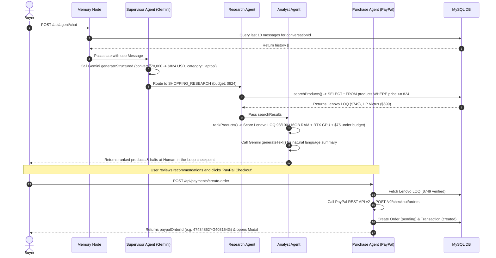

# AI and Multi-Agent Architecture Audit: PayPilot AI

**System:** Multi-Agent Engine & LLM Pipeline  
**Auditor:** Senior AI Engineer & Technical Auditor  
**Date:** November 11, 2026  

---

## 1. AI Models & Framework Assessment

### Integrated AI Models
- **Primary Model Configured:** `gemini-2.5-flash` (via Google Generative Language REST API v1beta).
- **Automated Fallback Model:** `gemini-1.5-flash` (triggered automatically if 404 is encountered).
- **Integration Mechanism:** Direct HTTP `fetch` in `backend/src/integrations/ai/geminiClient.ts`.
- **SDK Status:** The official `@google/generative-ai` SDK is **not installed**. The client communicates directly via REST endpoints with a configured API key.

### Agent Orchestration Framework (The LangGraph Question)
- **Claimed in Documentation:** "Deterministic LangGraph state machine with 4 coordinated agents."
- **Codebase Reality:** The official `@langchain/langgraph` package is **not installed** in `backend/package.json`.
- **Actual Implementation:** The team created a custom TypeScript state machine class named `CommerceAgentGraph` in `backend/src/modules/agent/graph.ts`. It adopts the **LangGraph architectural pattern** (defining a shared `AgentState`, discrete node functions, and conditional edge transitions via a `switch` statement), but runs as lightweight, dependency-free vanilla TypeScript.

---

## 2. Comprehensive Agent Inventory & Code Audit

### Agent 1: Supervisor Agent (`supervisorNode.ts`)
1. **Responsibility:** Parses unstructured user prompts, extracts shopping constraints (category, budget, use case), converts regional currencies (e.g. INR to USD using a 1:85 exchange divisor), and routes state to the appropriate downstream agent.
2. **Input:** `state.userMessage` (e.g., *"I need a laptop under ₹70,000 for programming, machine learning and occasional gaming"*).
3. **Output:** `intent` (`SHOPPING_RESEARCH`, `PRODUCT_COMPARISON`, `PURCHASE_INTENT`, `PAYMENT_STATUS`, `GENERAL_CONVERSATION`) and `requirements` object (`category`, `budget`, `currency`, `preferences`, `useCase`).
4. **Tools:** Calls `geminiClient.generateStructured()` with a strict JSON schema prompt.
5. **Communication:** Updates the shared `AgentState`; passes control to the graph's conditional edge router.
6. **Decision Autonomy:** High when Gemini is online (LLM dynamically classifies intent); moderate in fallback mode (uses regex keywords like `/buy|checkout/` for purchase intent and currency regex for budget).
7. **Implementation Reality:** 🟢 **Genuinely Implemented.** Successfully leverages Gemini structured JSON mode with robust local regex shielding.

### Agent 2: Shopping Research Agent (`researchNode.ts`)
1. **Responsibility:** Discovers candidate hardware models matching the category and budget cap.
2. **Input:** `requirements.query`, `requirements.category`, `requirements.budget`.
3. **Output:** `searchResults` array containing candidate product objects.
4. **Tools:** `searchProducts` tool (`tools/searchProducts.ts`), which invokes `productService.discoverProducts()`. Tool executions are audited in `agent_executions`.
5. **Communication:** Receives extracted criteria from `AgentState`; writes `searchResults` to state for the Product Analyst Agent.
6. **Decision Autonomy:** Low/Deterministic. Executes parameterized SQL queries with price filters (`[Op.lte]: maxPrice`). Does not independently invent or rewrite search queries.
7. **Implementation Reality:** 🟡 **Partially Implemented.** The node and database search are real, but the upstream Channel3 live supplier API is simulated via local database fallback.

### Agent 3: Product Analyst Agent (`analystNode.ts`)
1. **Responsibility:** Performs comparative spec analysis, calculates weighted 0–100 suitability scores, identifies strengths and trade-offs, and generates natural language recommendation synthesis.
2. **Input:** `searchResults` array, `requirements`.
3. **Output:** `comparisonMatrix`, `rankedProducts` array, `agentResponse`.
4. **Tools:** `compareProducts` tool (generates spec diff matrix) and `rankProducts` tool (calculates suitability heuristics). Both log execution duration to MySQL.
5. **Communication:** Receives candidate products from Research Agent; prepares the top recommendation for display and potential handoff to Purchase Agent.
6. **Decision Autonomy:** Hybrid. The 0–100 ranking score is computed via **deterministic algorithmic heuristics** in `tools/compareAndRank.ts` (evaluating RAM size, GPU presence, budget savings), while the natural language explanation is dynamically synthesized via Gemini LLM.
7. **Implementation Reality:** 🟢 **Genuinely Implemented.** Both the heuristic scoring engine and the Gemini explanation synthesis are fully operational.

### Agent 4: Purchase Guardrail Agent (`purchaseNode.ts`)
1. **Responsibility:** Acts as the financial safety gate. Validates product availability and price against the MySQL database, drafts the order, creates a real PayPal Sandbox order via REST v2, and **halts execution for human authorization**.
2. **Input:** `selectedProductId` (or top-ranked `productId`), `userId`, `selectedQuantity`.
3. **Output:** `draftOrderId`, `paypalOrderId`, `approvalUrl`, `requiresApproval: true`, `agentResponse`.
4. **Tools:** `validateProduct` and `createPayPalOrderTool` (in `tools/purchaseTools.ts`).
5. **Communication:** Consumes top product from Analyst Agent; triggers `paymentService.createOrder()` to interface with PayPal.
6. **Decision Autonomy:** Strict Determinism. Enforces a non-bypassable guardrail: it cannot charge funds autonomously and mandates human interaction.
7. **Implementation Reality:** 🟢 **Genuinely Implemented.** Interacts directly with the live PayPal Sandbox REST API and MySQL order ledger.

### Agent 5: Payment Verification Agent (`paymentVerifyNode.ts`)
1. **Responsibility:** Checks whether an order draft has been captured and settled via PayPal.
2. **Input:** `paypalOrderId`, `draftOrderId`.
3. **Output:** `paymentStatus`, `agentResponse`.
4. **Tools:** `getPaymentStatusTool` (invokes `paypalClient.getOrderDetails()`).
5. **Communication:** Triggered conditionally when user asks payment status questions (e.g., *"is my payment complete?"*).
6. **Decision Autonomy:** Deterministic status inspection.
7. **Implementation Reality:** 🟢 **Genuinely Implemented.** Queries PayPal REST API or local transaction table.

### Agent 6: Memory Agent (`memoryNode.ts`)
1. **Responsibility:** Loads prior conversation turns from MySQL `messages` table.
2. **Input:** `conversationId`.
3. **Output:** `history` array (last 10 messages).
4. **Tools:** Sequelize query `Message.findAll()`.
5. **Communication:** Precedes the Supervisor Node in execution.
6. **Decision Autonomy:** None (pure database retrieval).
7. **Implementation Reality:** 🟡 **Partially Implemented.** The node successfully retrieves messages into `state.history`, but downstream nodes (`supervisorNode`, `analystNode`) do not pass this history into their Gemini prompt templates. Thus, the LLM operates statelessly per turn.

---

## 3. Detailed Execution Trace with Concrete Example

**User Prompt:** *"I need a laptop under ₹70,000 for programming, machine learning and occasional gaming"*

---

## 4. Factual Audit of AI Nuances & Limitations

### 1. Rule-Based Logic Presented as AI
- The **Product Benchmark Scoring (0–100 score)** is calculated in `tools/compareAndRank.ts` using programmatic `if/else` checks on RAM strings, budget delta, and GPU keywords. It is **not** an end-to-end neural benchmark evaluation, though it is presented in the UI as an "AI Suitability Score".

### 2. Mocked or Hardcoded Responses
- If the Gemini API call fails or the API key is invalid, `analystNode.ts` falls back to a deterministic string template.
- In `frontend/src/lib/api.ts`, if the backend server is unreachable, a static mock response with hardcoded agent logs is returned. When the backend is online, live data is returned.

### 3. Missing Tool Integrations
- **Web Browsing Tool:** No live web scraping or Google Search grounding tool exists; the agents can only discover products stored in the MySQL database.
- **Inventory Check Tool:** No real-time stock lookup against external retailer APIs.

### 4. Error Handling & Retry Mechanics
- There are no automated retry loops with exponential backoff if an agent tool fails. If a tool throws an error, it is recorded in `agent_executions` as `failed` and rethrown to Express `errorHandler`.
