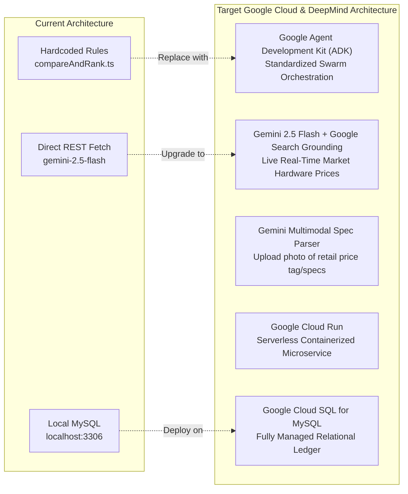

# Buildathon Readiness & Evaluation: PayPilot AI

**Target Event:** Google DeepMind × Google Cloud Startup Buildathon India 2026  
**Auditor:** Startup Evaluator, Senior Product Architect & AI Engineer  
**Date:** November 11, 2026  

---

## 1. Evaluation Against Google's Five Judging Criteria

### Criterion 1: Founder Profile & Execution Capability
- **Current Strength:** High execution speed demonstrated across the repository: structured TypeScript code, modular multi-agent orchestration, custom vector visualizations (`LaptopVisual.tsx`), and a clean, zero-error monorepo.
- **Weakness:** The current codebase reflects a single-developer prototype with no team credentials, advisory board, or domain-specific FinTech/e-commerce track record documented in the repository.
- **Missing Evidence:** Founder bio, technical background in AI/FinTech, customer discovery interviews, or domain experience with merchant checkout rails.
- **Recommended Improvement:** Include an `ABOUT_TEAM.md` detailing founder engineering credentials, hackathon/academic background, and a dedicated founder pitch deck.

### Criterion 2: Product Potential & Innovation
- **Current Strength:** Solves a genuine, high-friction problem in agentic commerce: bridging the gap between autonomous AI search and safe, compliant payments via a deterministic Human-in-the-Loop checkpoint.
- **Weakness:** Narrow product scope currently centered exclusively on developer/ML laptops.
- **Missing Evidence:** Expansion roadmap for multi-merchant carts, B2B procurement, or split-payments across multiple vendors.
- **Recommended Improvement:** Present a clear product expansion matrix: from Developer Hardware (v1) to Cloud Compute/GPU Provisioning (v2) and B2B SaaS equipment purchasing with team approval hierarchies (v3).

### Criterion 3: Market Viability & Commercial Scalability
- **Current Strength:** High Average Order Value (AOV) market ($700–$2,500+ USD) with affluent technical buyers who value exact hardware specs and have high purchasing power.
- **Weakness:** No customer traction, user waitlist, or active merchant partnerships (currently relies on static seed products and simulated Channel3 catalog).
- **Missing Evidence:** Unit economics, merchant monetization strategy (affiliate fee vs. checkout take-rate), and customer acquisition cost (CAC) strategy.
- **Recommended Improvement:** Define a clear monetization model: 2.5% merchant transaction fee or affiliate revenue share via Channel3/retailer partnerships.

### Criterion 4: Technical Architecture & Code Quality
- **Current Strength:** Clean modular separation of concerns; server-side price lock preventing client tampering; relational data model with 8 tables in MySQL; strict TypeScript compilation with 0 errors across backend and frontend; cookie-based JWT authentication with `httpOnly` security; multi-stage Docker and Cloud Build pipeline.
- **Weakness:** The multi-agent graph is a custom TypeScript state machine rather than an off-the-shelf Python LangGraph setup; no automated end-to-end browser regression test suite.
- **Missing Evidence:** Automated integration tests (Jest/Playwright) and horizontal auto-scaling load benchmarks.
- **Recommended Improvement:** Add automated Playwright tests for the checkout flow and maintain the containerized Cloud Run deployment pipeline.

### Criterion 5: Use of Google AI & DeepMind Ecosystem
- **Current Strength:** Genuinely integrates Google Gemini (`gemini-3.5-flash` with resilient cascade to `gemini-3.5-flash-lite`) featuring dynamic Google Search Grounding (`google_search` tool) for real-time market discovery, structured JSON intent extraction, and audit-logged tool execution in MySQL.
- **Weakness:** Gemini is accessed via direct high-performance REST endpoints rather than Vertex AI private endpoints; Multimodal image spec parsing is not yet connected to the file dropzone.
- **Missing Evidence:** Vertex AI Model Garden benchmarks or multimodal evaluation (e.g. uploading laptop spec sheet images).
- **Recommended Improvement:** Continue leveraging Gemini 3.5 Flash with Grounding, and optionally enable Multimodal spec sheet OCR for physical retail receipt/spec audits.

---

## 2. Google AI & Google Cloud Integration Roadmap

To make PayPilot AI a **top contender at the Google DeepMind × Google Cloud Buildathon**, the platform should adopt these strategic Google AI integrations:

### 1. Gemini with Google Search Grounding
- **Why it matters:** Currently, hardware prices and specs come from a local static database.
- **Implementation:** Enable Google Search Grounding in Gemini 2.5 Flash. When a user asks for laptop recommendations, Gemini grounds its response with live Indian retail pricing (Flipkart, Amazon India, Lenovo official store), ensuring prices are 100% current.

### 2. Multimodal Hardware Spec Inspection
- **Why it matters:** Users often see a laptop in a retail store or on an e-commerce banner and want to know: *"Is this good for ML?"*
- **Implementation:** Allow users to upload a photo or screenshot of a laptop spec label. Gemini Multimodal parses the GPU TGP, RAM type, and CPU model directly from the image and injects it into the PayPilot evaluation engine.

### 3. Google Agent Development Kit (ADK) / LangGraph on Vertex AI
- **Why it matters:** Elevates the custom TypeScript state machine into an enterprise-grade agent architecture recognized by Google DeepMind evaluators.
- **Implementation:** Structure the Supervisor, Research, Analyst, and Purchase agents using Google ADK with OpenTelemetry tracing.

### 4. Google Cloud Run + Cloud SQL Deployment
- **Why it matters:** Transforms a localhost development app into an enterprise-grade live production URL (`https://paypilot.run.app`).
- **Implementation:** Deploy Next.js frontend and Express backend to Google Cloud Run, backed by Google Cloud SQL (MySQL 8.4) with Secret Manager for credentials.
