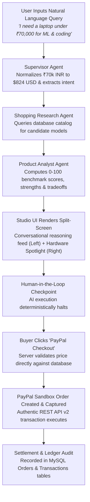

# Executive Product Overview: PayPilot AI

**Product Name:** PayPilot AI  
**Repository:** [github.com/abhisheksenku/PayPilot-AI](https://github.com/abhisheksenku/PayPilot-AI)  
**Evaluation Target:** Google DeepMind × Google Cloud Startup Buildathon India 2026  
**Auditor Role:** Senior Product Architect, AI Engineer, Technical Auditor & Startup Evaluator  
**Audit Date:** November 11, 2026  

---

## 1. Executive Summary

PayPilot AI is an **agentic e-commerce platform** engineered to solve the technical discovery, comparative benchmarking, and checkout friction associated with high-consideration developer and machine learning hardware. The application pairs natural-language conversational requirement extraction with an autonomous multi-agent reasoning pipeline, culminating in a **Human-in-the-Loop (HITL) financial checkout terminal** governed by official PayPal REST APIs.

Rather than presenting an uncurated list of sponsored e-commerce links, PayPilot AI evaluates hardware specifications (GPU Total Graphics Power / TGP wattage, memory bandwidth, compute architecture, thermal constraints, display color accuracy) against a declared budget ceiling, locks the verified merchant price server-side, and stages a cryptographic transaction requiring manual biometric/credential authorization before capital capture.

---

## 2. Core Problem Space

### The Shopper Dilemma in Technical Hardware
Procuring developer and ML hardware is inherently confusing and fragmented:
1. **Misleading Spec Sheets & Thermal Throttling:** Two laptops carrying an "NVIDIA RTX 4060" can perform drastically differently in tensor operations and PyTorch model fine-tuning (e.g., an uncapped 140W/115W TGP versus a thermally constrained 45W/75W mobile variant).
2. **Hidden Bottlenecks:** Soldered 8GB/16GB non-upgradeable LPDDR memory frequently cripples local LLM inference (e.g., running Ollama, Llama 3, or quantized models), but this limitation is rarely surfaced upfront on retail sites.
3. **Cross-Currency & Regional Friction:** Indian developers often conceptualize budgets in INR (e.g., *"₹70,000"*), whereas global hardware catalogs, merchant rails, and developer benchmarks are indexed in USD.

### The Agentic Commerce Dilemma
Modern AI shopping agents currently suffer from two operational extremes:
1. **Toy Chatbots:** Conversational wrappers that regurgitate Amazon/Google search affiliate links without structured hardware evaluation, order drafting, or purchasing capabilities.
2. **Unconstrained Auto-Buyers:** Autonomous scripts possessing direct credit card access that execute transactions autonomously—an approach that violates financial regulations and terrifies consumers.

PayPilot AI addresses both issues by giving agents **full discovery and benchmarking autonomy**, but **zero autonomous payment authority**, enforcing a deterministic human approval checkpoint.

---

## 3. Target Audience

1. **Software Engineers & AI Researchers:** Developers looking for CUDA-compatible laptops, workstations, or Apple Silicon machines capable of running local containers, IDEs, and deep learning libraries within strict budget boundaries.
2. **STEM Students & Indie Hackers:** First-time hardware buyers who need clear, jargon-free trade-off explanations (e.g., battery life vs. chassis weight vs. TGP wattage) in local currency (INR).
3. **Enterprise DevSecOps & Tech Leads:** Small tech teams managing equipment stipends who require itemized tax invoices, verified ledger records, and auditable proof that funds were disbursed to verified merchant hardware.

---

## 4. Core Value Proposition

| Dimension | Traditional E-Commerce (Amazon, Best Buy, Flipkart) | Generic AI Chatbots (ChatGPT, Perplexity) | PayPilot AI Platform |
| :--- | :--- | :--- | :--- |
| **Discovery Mechanism** | Manual facet filters and sponsored search ads | Text answers with external retail links | Constraint-driven multi-agent query decomposition |
| **Technical Benchmarking** | Raw unnormalized manufacturer bullet points | Superficial summaries without tensor/wattage scoring | 0–100 Multi-Attribute scoring (TGP, RAM bandwidth, thermals) |
| **Pricing & Checkout** | Unlocked dynamic cart prone to flash price spikes | No checkout capability (external handoff) | Server-side cryptographic price lock against backend catalog |
| **Payment Execution** | Standard multi-step checkout funnel | None | Integrated PayPal Sandbox REST API v2 modal right in studio |
| **Post-Purchase Audit** | Fragmented order confirmation emails | None | Relational ledger with PayPal capture IDs and JSON webhook telemetry |

---

## 5. End-to-End User Journey

---

## 6. Primary Platform Capabilities

1. **Conversational Multi-Turn Hardware Studio (`/studio`):**
   - Left-pane multi-turn chat stream supporting sequential queries (e.g., Turn 1: *"Under ₹70,000"* $\to$ Turn 2: *"Can you find a 32GB RAM option?"*).
   - Expandable `Multi-Agent Analysis — Completed (4/4) ▾` telemetry accordions.
   - Auto-collapsing previous question summary pills (`Q1: Find gaming laptop... • Completed`).
2. **Persistent Hardware Spotlight & Checkout Terminal (`/studio` right rail):**
   - High-fidelity vector renders (`LaptopVisual.tsx`) matching specific laptop chassis (Lenovo LOQ, ASUS ROG, MacBook Pro, HP Victus, Dell G15).
   - 3-button PayPal Sandbox stack (`PayPal Checkout`, `Pay Later`, `Debit or Credit Card`).
3. **Verified Hardware Catalog (`/catalog`):**
   - 6 pre-seeded benchmarked models with top-pick badges and Channel3 source tags.
   - Filterable by Category (`ML Laptops`, `MacBooks`, `Workstations`) and Brand.
4. **Institutional Financial Ledger (`/transactions`):**
   - 8-column transaction table logging Transaction IDs, PayPal Order IDs, Capture IDs, amounts, and settlement statuses.
   - Interactive REST API v2 Webhook Payload inspector modal (`PAYMENT.CAPTURE.COMPLETED`).
   - One-click CSV export utility.
5. **Orders & Digital Tax Invoices (`/orders`):**
   - Master-detail order management with status indicators (`DELIVERED`, `IN_TRANSIT`, `ON_HOLD`).
   - Official PayPal Digital Sales Receipt & Tax Invoice with QR verification code and printable browser layout.
