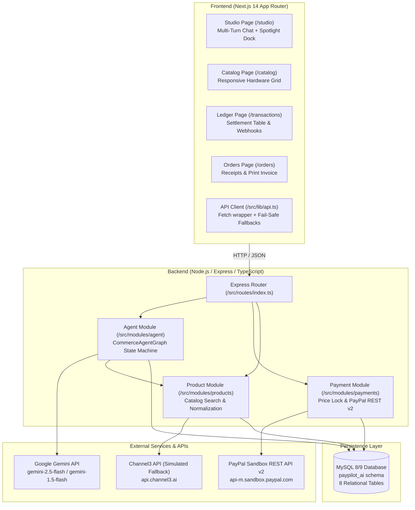
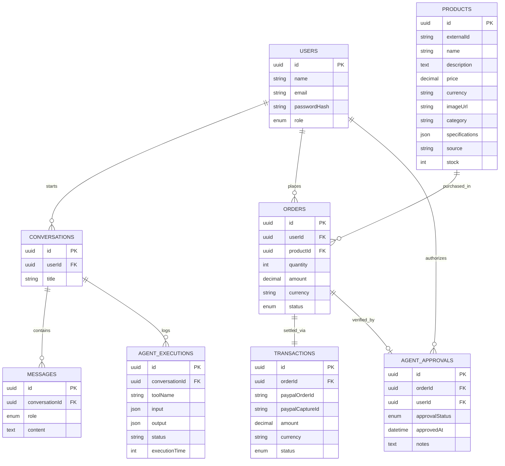

# Technical Architecture: PayPilot AI

**System:** PayPilot AI Architecture Specification & Code Audit  
**Auditor:** Senior Product Architect & Technical Auditor  
**Date:** November 11, 2026  

---

## 1. System Overview & Technology Stack

PayPilot AI is built as a decoupled full-stack TypeScript monorepo containing a modern Next.js client and an Express/Sequelize microservice backend.

### Technology Versions & Tooling

| Component | Technology | Version | Purpose |
| :--- | :--- | :--- | :--- |
| **Frontend Framework** | Next.js (App Router) | `14.2.15` | Client UI, SSR/CSR pages, responsive layouts |
| **UI Library** | React | `18.3.1` | Component lifecycle, hooks, state management |
| **Styling** | Tailwind CSS | `3.4.14` | PayPal Developer Console theme tokens |
| **Icons** | Lucide React | `0.460.0` | Comprehensive vector iconography |
| **Checkout SDK** | `@paypal/react-paypal-js` | `8.7.0` | Client-side PayPal funding buttons |
| **Visual Effects** | `canvas-confetti` | `1.9.4` | Payment confirmation celebratory particles |
| **Backend Framework** | Express.js | `4.21.2` | RESTful routing, middleware, controllers |
| **Language** | TypeScript | `5.7.3` (BE) / `5.6.3` (FE) | Full static type-safety across stack |
| **ORM** | Sequelize | `6.37.5` | Relational mapping, schema synchronization |
| **Database Driver** | `mysql2` | `3.12.0` | Connection pooling to MySQL 8.x / 9.x |
| **Input Validation** | Zod | `3.24.1` | Schema parsing & runtime validation |
| **Security & Headers** | Helmet | `8.0.0` | HTTP header security hardening |
| **Environment** | Dotenv | `16.4.7` | Key-value configuration loader |

---

## 2. API Endpoint Inventory

The Express server exposes endpoints mounted under both `/api` and `/api/v1` prefixes via `backend/src/routes/index.ts`:

| Method | Endpoint Path | Controller Handler | Authentication | Description |
| :--- | :--- | :--- | :--- | :--- |
| **`GET`** | `/api/health` | `healthController.checkHealth` | Public | Verifies server and MySQL database connectivity. |
| **`POST`** | `/api/agent/chat` *(or `/api/v1/agent/chat`)* | `agentController.chat` | Public / Demo User | Executes the multi-agent state graph pipeline for a user message. |
| **`GET`** | `/api/agent/executions/:conversationId` | `agentController.getExecutions` | Public | Returns chronological audit log of all tool executions for a conversation. |
| **`GET`** | `/api/products` *(or `/api/v1/products`)* | `productController.getProducts` | Public | Queries catalog with optional category, price, and query filters. |
| **`GET`** | `/api/products/:id` | `productController.getProductById` | Public | Retrieves specific hardware product details by primary key UUID. |
| **`POST`** | `/api/payments/create-order` | `paymentController.createOrder` | Public / Demo User | Validates product price against database, drafts order in MySQL, and creates real PayPal Sandbox order via REST v2. |
| **`POST`** | `/api/payments/capture-order` | `paymentController.captureOrder` | Public / Demo User | Calls PayPal Sandbox capture API with idempotency and updates database order/transaction records. |
| **`GET`** | `/api/payments/orders` | `paymentController.getOrders` | Public | Retrieves recent orders with associated product and transaction details. |
| **`GET`** | `/api/payments/order/:orderId` | `paymentController.getOrderDetails` | Public | Returns specific order status and transaction payload. |

---

## 3. Database Schema & Entity Relationships

The MySQL database (`paypilot_ai`) contains **8 core tables** synchronized via Sequelize in `backend/src/models/index.ts`:

### Table Breakdown

1. **`users`**: User identity accounts. In current testing, defaults to UUID `'00000000-0000-0000-0000-000000000001'` ('Demo Shopper').
2. **`conversations`**: Shopping sessions initiated by users.
3. **`messages`**: Transcript history of user prompts and agent responses.
4. **`products`**: Hardware catalog storing prices, specifications (JSON), and external IDs.
5. **`orders`**: Draft and fulfilled purchase orders with foreign keys to user and product.
6. **`transactions`**: Financial settlement records tracking `paypalOrderId` and `paypalCaptureId`.
7. **`agent_executions`**: Audit trail logging every tool execution, JSON payload, and runtime duration in milliseconds.
8. **`agent_approvals`**: Audit record recording human-in-the-loop authorization events.

---

## 4. Architectural Data Flows

### A. Conversational Search & Benchmark Scoring
1. User enters natural language prompt in `/studio`.
2. Frontend dispatches `POST /api/agent/chat`.
3. `agentService.ts` logs message in MySQL `messages`.
4. `CommerceAgentGraph` runs:
   - `memoryNode`: Reads last 10 messages from DB.
   - `supervisorNode`: Calls Gemini API (or regex fallback) to extract intent, category, and converts INR to USD.
   - `researchNode`: Calls `searchProducts` tool $\to$ queries MySQL `products` table.
   - `analystNode`: Computes weighted scores via `rankProducts` tool; calls Gemini to generate natural language synthesis.
5. Tool runs are persisted to `agent_executions` table.
6. Final `AgentState` returns to frontend with ranked product cards.

### B. Server-Side Price Locking & PayPal Checkout
1. User clicks **"PayPal Checkout"** in `/studio`.
2. Frontend dispatches `POST /api/payments/create-order` passing `productId`.
3. `paymentService.ts` fetches product from MySQL by primary key UUID (preventing client-side price tampering).
4. Order draft created in `orders` (status `pending`).
5. Backend invokes `paypalClient.createOrder()` against PayPal Sandbox REST API v2 (`https://api-m.sandbox.paypal.com/v2/checkout/orders`).
6. PayPal returns real sandbox order ID (`474...` or `57H...`) and approval link.
7. Record saved in `transactions` (status `created`).
8. Client triggers `POST /api/payments/capture-order`.
9. `paypalClient.captureOrder()` executes PayPal Sandbox REST capture (`/v2/checkout/orders/{id}/capture`).
10. `transactions` status updated to `completed` with genuine `paypalCaptureId`; `orders` updated to `paid`.
