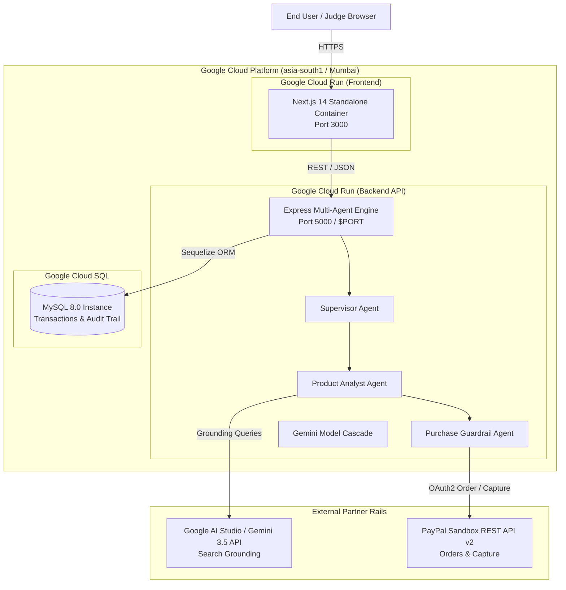

# PayPilot AI — Production Deployment Guide
**Target Event:** Google DeepMind × Google Cloud Startup Buildathon India 2026  
**Stack:** Next.js 14 (Frontend) + Node.js/Express (Backend Multi-Agent Engine) + MySQL 8 + Google Gemini API + PayPal Sandbox REST v2

---

## 1. Architecture Overview



---

## 2. Deployment Methods

### Method A: Local / Evaluator 1-Click Reproduction (Docker Compose)

For instant evaluation without setting up remote cloud credentials, run:

```bash
# Clone the repository
git clone https://github.com/abhisheksenku/PayPilot-AI.git
cd PayPilot-AI

# Provide your Gemini & PayPal Sandbox keys (or test with built-in fallbacks)
cp backend/.env.example backend/.env
# Edit backend/.env with your GEMINI_API_KEY and PAYPAL credentials

# Start the complete stack (MySQL 8 + Backend Engine + Next.js Frontend)
docker compose up --build
```

**Access Endpoints:**
- **Studio Interface:** `http://localhost:3000/studio`
- **Catalog Browser:** `http://localhost:3000/catalog`
- **Transaction Ledger:** `http://localhost:3000/transactions`
- **Backend Health Check:** `http://localhost:5000/api/health`

---

### Method B: Google Cloud Run Deployment (Recommended for Buildathon)

Deploy directly to Google Cloud's serverless container infrastructure in the `asia-south1` (Mumbai) region.

#### Step 1: Initialize Google Cloud CLI & Enable Services
```bash
# Authenticate gcloud
gcloud auth login
gcloud config set project YOUR_GCP_PROJECT_ID

# Enable required Google Cloud APIs
gcloud services enable \
  run.googleapis.com \
  containerregistry.googleapis.com \
  cloudbuild.googleapis.com \
  sqladmin.googleapis.com \
  secretmanager.googleapis.com
```

#### Step 2: Set Up Google Cloud SQL (MySQL 8.0)
```bash
# Create Cloud SQL instance
gcloud sql instances create paypilot-mysql \
  --database-version=MYSQL_8_0 \
  --tier=db-f1-micro \
  --region=asia-south1

# Create database and user
gcloud sql databases create paypilot_ai --instance=paypilot-mysql
gcloud sql users create paypilot_user --instance=paypilot-mysql --password=YOUR_DB_PASSWORD
```

#### Step 3: Deploy Backend Multi-Agent Engine to Cloud Run
```bash
cd backend

gcloud run deploy paypilot-backend \
  --source . \
  --region asia-south1 \
  --platform managed \
  --allow-unauthenticated \
  --set-env-vars "\
NODE_ENV=production,\
DB_HOST=/cloudsql/YOUR_GCP_PROJECT_ID:asia-south1:paypilot-mysql,\
DB_PORT=3306,\
DB_NAME=paypilot_ai,\
DB_USER=paypilot_user,\
DB_PASSWORD=YOUR_DB_PASSWORD,\
GEMINI_API_KEY=YOUR_GEMINI_API_KEY,\
PAYPAL_MODE=sandbox,\
PAYPAL_CLIENT_ID=YOUR_PAYPAL_CLIENT_ID,\
PAYPAL_CLIENT_SECRET=YOUR_PAYPAL_CLIENT_SECRET,\
CLIENT_URL=https://YOUR_FRONTEND_URL.run.app" \
  --add-cloudsql-instances YOUR_GCP_PROJECT_ID:asia-south1:paypilot-mysql
```
*Take note of the resulting service URL (e.g., `https://paypilot-backend-xyz.a.run.app`).*

#### Step 4: Deploy Next.js Frontend to Cloud Run
```bash
cd ../frontend

gcloud run deploy paypilot-frontend \
  --source . \
  --region asia-south1 \
  --platform managed \
  --allow-unauthenticated \
  --set-env-vars "\
NEXT_PUBLIC_API_URL=https://paypilot-backend-xyz.a.run.app/api,\
NEXT_PUBLIC_PAYPAL_CLIENT_ID=YOUR_PAYPAL_CLIENT_ID,\
NEXT_PUBLIC_ENABLE_SEED_DATA=true"
```

---

### Method C: Hybrid Cloud (Vercel Frontend + Cloud Run / Render Backend)

For zero-latency static asset delivery and edge caching:
1. **Frontend:** Import the repository into **Vercel**, set the Root Directory to `frontend`, and configure:
   - `NEXT_PUBLIC_API_URL`: Your backend HTTPS endpoint.
   - `NEXT_PUBLIC_PAYPAL_CLIENT_ID`: Your PayPal Sandbox client ID.
2. **Backend:** Deploy `backend` container to **Google Cloud Run** or **Render** connected to your MySQL instance.
3. Update `CLIENT_URL` in the backend environment to match the Vercel domain to ensure strict CORS compatibility.

---

## 3. Environment Variable Specification

### Backend Variables (`backend/.env`)

| Variable | Type | Default | Description |
|---|---|---|---|
| `PORT` | Number | `5000` | HTTP port for Express server (Cloud Run automatically supplies `PORT=8080`) |
| `NODE_ENV` | String | `production` | Runtime mode (`development` / `production`) |
| `CLIENT_URL` | String | `http://localhost:3000` | Allowed CORS origins (supports comma-separated URLs) |
| `DB_HOST` | String | `127.0.0.1` | MySQL hostname or Cloud SQL socket path |
| `DB_PORT` | Number | `3306` | MySQL TCP port |
| `DB_USER` | String | `root` | Database username |
| `DB_PASSWORD` | String | `""` | Database password |
| `DB_NAME` | String | `paypilot_ai` | Database name |
| `GEMINI_API_KEY` | Secret | Required | Google AI Studio API Key for Gemini 3.5 & Search Grounding |
| `PAYPAL_MODE` | String | `sandbox` | PayPal operating mode (`sandbox` or `live`) |
| `PAYPAL_CLIENT_ID` | Secret | Required | PayPal REST API v2 App Client ID |
| `PAYPAL_CLIENT_SECRET` | Secret | Required | PayPal REST API v2 App Secret |
| `JWT_SECRET` | Secret | Required | Signing key for API session tokens |

### Frontend Variables (`frontend/.env.local`)

| Variable | Type | Default | Description |
|---|---|---|---|
| `NEXT_PUBLIC_API_URL` | String | `http://localhost:5000/api` | Base URL of backend REST endpoints |
| `NEXT_PUBLIC_PAYPAL_CLIENT_ID` | String | Required | Public PayPal Client ID for SDK button initialization |
| `NEXT_PUBLIC_ENABLE_SEED_DATA` | Boolean | `true` | Enables verified benchmark demo products |

---

## 4. Health Checks & Verification

After deployment, verify that both containers are running healthy:

```bash
# 1. Verify Backend Health and MySQL connectivity
curl -I https://YOUR_BACKEND_URL/api/health
# Expected: HTTP/1.1 200 OK

# 2. Verify Product Catalog Retrieval
curl -s https://YOUR_BACKEND_URL/api/products | grep "Lenovo LOQ"
# Expected: JSON response containing Lenovo LOQ and ASUS ROG

# 3. Test Multi-Agent Intent & Grounding Engine
curl -X POST https://YOUR_BACKEND_URL/api/agent/chat \
  -H "Content-Type: application/json" \
  -d '{"message": "I need a laptop under ₹85,000 for ML"}'
# Expected: JSON containing activeAgent: "analyst", rankedProducts, and verified PayPal draft
```
